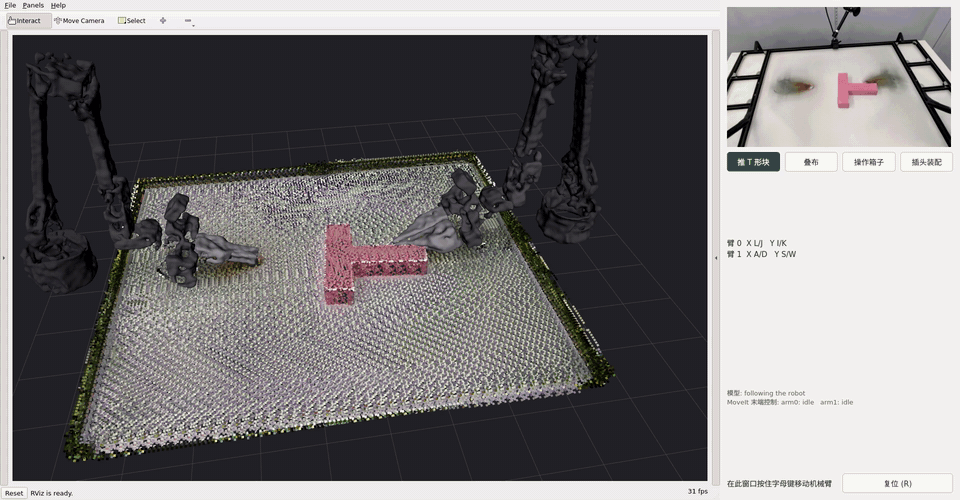
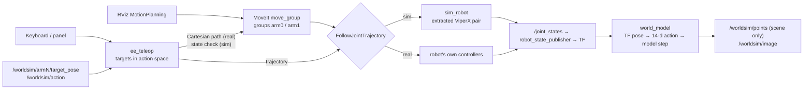
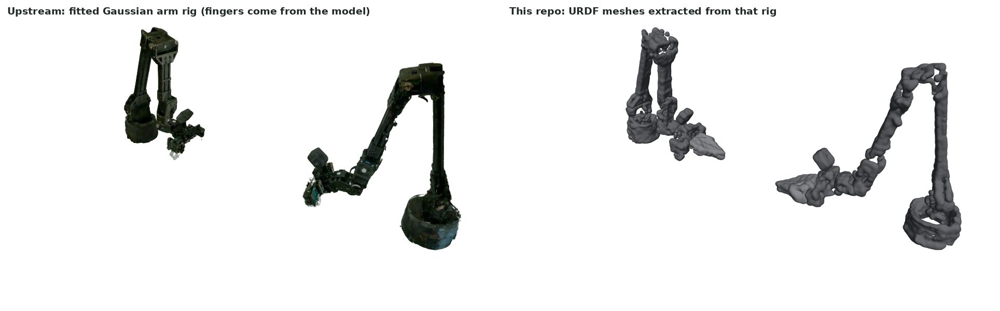
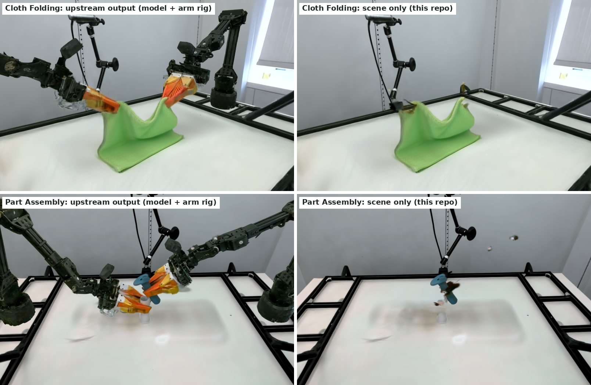
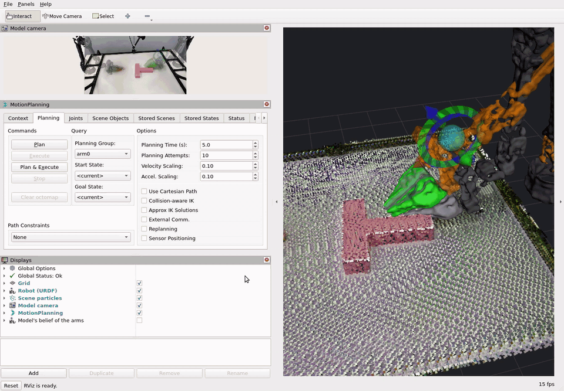
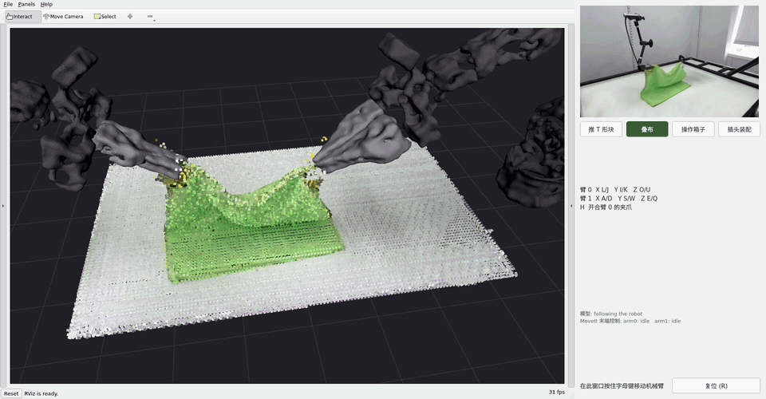
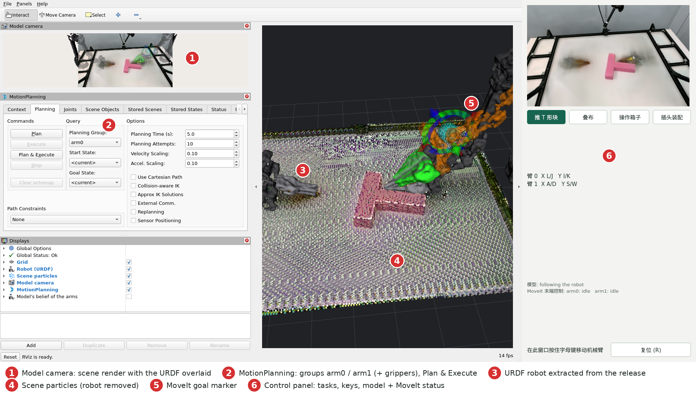

# WorldSim ROS 2 — drive a learned 3D world model with a real robot stack

[中文说明](README.zh-CN.md)

A ROS 2 Humble / MoveIt 2 integration of **[Hybrid Particle-Voxel Dynamics for Multimodal 3D World Simulation](https://github.com/jwang771/3d-world-simulator)**
(Wang et al., 2026). The learned world model runs locally on one consumer GPU. The robot is a proper URDF
**extracted from the released checkpoints**, end effectors are commanded through **MoveIt planning groups**,
and the same nodes serve **simulation and a real robot**.



> The world model and its weights are the work of the original authors. This repository is a fork of
> [jwang771/3d-world-simulator](https://github.com/jwang771/3d-world-simulator): their code at the top level is
> unchanged, and everything added lives in this `ros2/` folder. The weights are downloaded from their Hugging Face
> repository (see [Setup](#setup)).

## What this adds to the upstream release

| | Upstream interactive demo | This repository |
|---|---|---|
| Robot | Arms drawn as fitted Gaussian splats (`ArmRig`) | **URDF** with meshes, extracted from `arms/rig.pt` (`tools/extract_robot.py`) |
| Scene output | All Gaussians, arms included | **Scene only**: robot Gaussians removed (incl. gripper pads labelled as object); held objects kept |
| Control | Keyboard / web gizmo moving a commanded pose | **MoveIt 2 planning groups** `arm0` / `arm1` (+ grippers): keyboard, pose topics, RViz MotionPlanning |
| Action ↔ robot | Action is a 14-d pose vector | Action is a **TF lookup** on the URDF (`armN_action_frame → armN_action_tcp`), calibrated from the release |
| Interface | Web page | ROS 2 topics: `PointCloud2`, `Image` + `CameraInfo`, `JointState`, `FollowJointTrajectory` |
| Robots | — | Kinematic simulation of the training robot, and a **real-robot backend** (example config: dual-arm humanoid) |

## How it works



The model is only stepped when the measured action changes (plus a short run-on, and a settle period after a gripper
change), exactly like the upstream demo, so a still robot means a still scene.

## Results



**Robot extraction.** The kinematic chain comes from the joint table the authors exported from their URDF
(`arms/rig.pt → fk`). Each link's mesh is built from that link's fitted Gaussians (voxelised and meshed with marching
cubes), and its collision geometry is the mesh's convex hull. The meshes are coarser than the vendor meshes, but they are
derived only from the release.

**The action is a commanded pose, not a link pose.** Running the release's own arm head (`ArmRig.joint_net`) on every
frame of the four seed episodes gives the joints the model believes in. A least-squares fit then finds, per arm, a fixed
`action_frame` (relative to `base_link`) and `action_tcp` (relative to `gripper_link`). Findings:

- The action leads the arm by about **2 model steps (0.2 s)**. It is the teleoperation command, and the arm lags behind it.
- Orientation is **roll-pitch-yaw about fixed x, y, z axes**, the ROS convention. Intrinsic XYZ or zyx orders leave a 1.2–2.1× larger rotation residual.
- Residuals after the fit, over 1,180 frames per arm, are about as large as the joint head's own error:

| arm | position, median | position, p90 | rotation, median |
|---|---|---|---|
| arm 0 | 7.1 mm | 12.5 mm | 3.0° |
| arm 1 | 9.8 mm | 18.3 mm | 2.6° |

With these two links in the URDF, any joint source yields a model action with a single TF lookup.



**Scene only.** Dropping the robot class is not enough: the gripper pads are labelled *object*, and some arm parts
are labelled *table*. The release's arm rig locates the model's own arms. Within a dilated voxel mask around them,
table-class Gaussians off the table surface and red/orange pad Gaussians are removed. Object Gaussians held in the
gripper (cloth, plug) are kept.





**The ViperX wrist singularity.** Lowering an arm through the cloth workspace takes `wrist_angle` through 0, where
`forearm_roll` and `wrist_rotate` share an axis. MoveIt's KDL and LMA plugins drift there into a 180° wrist flip
(both joints spin by about π in opposite directions, so a 10 cm move takes 2 s and the TCP leaves the line when
preempted); pick_ik with a displacement cost stalls. Streaming end-effector control of the simulated arms therefore
solves each 3 mm Cartesian step with the core's damped IK (adaptive damping near the singularity, position weighted
above orientation, orientation held to 1.1°, inside the fitted frame's 3°), and MoveIt's planning group checks the
result for collisions before it is sent. The wrist then crosses zero as the recorded arms did. RViz goal markers and
OMPL planning still use MoveIt's IK. A real robot uses MoveIt's Cartesian path.

**Motion the model was trained on.** The data moves about one keyboard step (3.5–4 mm) per 0.1 s step. Absolute
targets are therefore approached one step per tick, as the upstream gizmo does. Faster robot motion (the MoveIt panel,
a real arm) is fed to the model in up to 4 interpolated sub-steps per tick.

**Performance** (RTX 4070 Laptop, 8 GB, reference inference): dynamics step 20–70 ms, scene decode with robot removal
≈ 100 ms, 640×400 render ≈ 5 ms (after warm-up). Default rate 5 model steps/s; peak GPU memory ≈ 2.6 GB. `fast:=true` enables the
upstream sparse decoder and compiled dynamics.

## Setup

Tested on Ubuntu 22.04, ROS 2 Humble, MoveIt 2.5, Python 3.10, PyTorch with CUDA 13.0, RTX 4070 Laptop.

```bash
# ROS dependencies
sudo apt install ros-humble-moveit ros-humble-ros2-controllers python3-pyqt5

# This fork (upstream code at the top level, tested at upstream commit fc80d4b), branch ros2-integration
git clone -b ros2-integration https://github.com/<TODO-your-username>/3d-world-simulator.git
cd 3d-world-simulator/ros2

# Python inference environment: .venv on top of an existing Python 3.10 + PyTorch (CUDA 13.0) install
WORLDSIM_TORCH_PYTHON=/path/to/python-with-torch tools/setup_runtime.sh

# Released weights (~860 MB, checksum-verified) into assets/checkpoints
python3 tools/fetch_weights.py

# Build
source /opt/ros/humble/setup.bash
colcon build --base-paths src --symlink-install
```

The extracted robot (`src/worldsim_description`) is committed, so you do not need to run `tools/extract_robot.py`
unless you want to regenerate it.

## Simulation

```bash
./run_sim.sh                      # T pushing; task:=pusht|cloth|box|assembly
./run_sim.sh task:=cloth          # cloth folding, gripper on H
./run_sim.sh mode:=replay         # the recorded actions, looped; the arms follow by IK
./run_sim.sh model_arms:=true     # also show where the model itself believes the arms are
```

- **Control panel**: hold the task's keys to move an end effector, use the task buttons to switch tasks, `R` to reset
  and `H` for the gripper. Key hints come from each task's `task.json`.
- **RViz → MotionPlanning**: group `arm0`/`arm1`, drag the goal marker, then Plan & Execute. For the grippers use
  `arm0_gripper`/`arm1_gripper` with the `open`/`closed` states.
- **Topics**:
  - `/worldsim/armN/target_pose` (`PoseStamped` in any TF frame)
  - `/worldsim/action` (14-d absolute target)
  - `/worldsim/key`, `/worldsim/reset`, `/worldsim/select_task`



The still figures are rendered from the model by `tools/render_readme_figures.py`. Pass `rviz_config:=<file>` to use
your own RViz layout.

## Real robot

The world model can follow a real robot's end effectors. Here the robot is driven by its own controllers,
teleoperation, or this repository's keyboard through **the robot's MoveIt planning groups**. The mapping is
**relative**: at start, reset or task switch, the robot's current end-effector poses are tied to the seed frame's
actions. From then on the model sees the robot's motion since that moment, rotated into each model arm's frame
(`axes`) and scaled (`scale`).

```bash
# with the robot's own stack running (robot_state_publisher, move_group, arm trajectory controllers)
ros2 launch worldsim_g2 real.launch.py task:=pusht                       # follow; keyboard plans only
ros2 launch worldsim_g2 real.launch.py task:=pusht enable_motion:=true   # keyboard moves the real arms (10 % speed)
```

The example configuration (`src/worldsim_g2/config/g2.yaml`) targets a dual-arm humanoid with groups
`left_arm_group` / `right_arm_group`. To use another robot, change the frames, group names and controller names there.

> **Status:** the real-robot path has only been tested against simulated TF frames and without a robot-side
> move_group. The model was trained on two ViperX arms, and its predictions under another embodiment are **not
> validated**.

<!-- TODO(media, optional): real_robot.gif. Real arm moving next to the predicted scene. Only if you are allowed to publish robot footage. -->

## Topics

| Topic | Type | |
|---|---|---|
| `/worldsim/points` | `PointCloud2` | predicted scene particles without the robot, frame `worldsim_world` |
| `/worldsim/image`, `/worldsim/camera_info` | `Image`, `CameraInfo` | the scene rendered over the scanned room |
| `/worldsim/applied_action` | `Float32MultiArray` | the 14-d action the model received |
| `/worldsim/seed_action` | `Float32MultiArray` (latched) | the seed frame's action after a reset; `layout.dim[0].label` = task |
| `/worldsim/state`, `/worldsim/teleop_state` | `String` (JSON) | model state; per-arm MoveIt control state |
| `/worldsim/action`, `/worldsim/armN/target_pose` | `Float32MultiArray`, `PoseStamped` | end-effector targets |
| `/worldsim/key`, `/worldsim/reset`, `/worldsim/select_task` | `String`, `Empty`, `String` | keyboard, reset, task |
| `/worldsim/gripper_command` | `Float32MultiArray` | gripper commands (task units) |

The 14-d action is, per arm in its action frame: x, y, z (m), roll, pitch, yaw (rad, fixed axes), gripper command. Arm 0 comes first.

## Repository layout

Inside `ros2/` (the top level of the repository is the unchanged upstream code):

```
src/worldsim_core         core algorithms, no ROS: engine (model, scene-only decode, render), robot (calibration,
                          FK/IK, URDF/SRDF), mapping (pose -> action, step gate), teleop, tasks; offline tests
src/worldsim_description  extracted URDF, meshes, calibration, MoveIt config (groups arm0, arm1, armN_gripper)
src/worldsim_model        nodes shared by sim and real: world_model, ee_teleop
src/worldsim_sim          sim backend sim_robot, launch, RViz layout, control panel, terminal keyboard
src/worldsim_g2           real-robot launch and example config, observation republisher
tools/                    extract_robot.py, setup_runtime.sh, fetch_weights.py, wspython
```

Offline tests (no ROS graph, no GPU): `python3 -m pytest src/worldsim_core/test -q`

## Limitations

- The meshes are reconstructed from splats and are coarser than vendor meshes.
- The training data holds no usable map from gripper command to finger opening, so the simulated finger opening is for display only.
- A thin table-layer shadow under the T-pushing grippers remains in the scene output. It is part of the predicted table.
- Arm mounts use the median over tasks: within 3 mm for every task, except part assembly's locked arm (≈ 2 cm).
- Cross-embodiment prediction (real robot ≠ ViperX) is unvalidated.

## Acknowledgements and citation

All credit for the world model, the arm rig, the datasets and the weights goes to the original authors. If you use this
work, please cite their paper:

```bibtex
@article{wang2026hybrid,
  title   = {Hybrid Particle-Voxel Dynamics for Multimodal 3D World Simulation},
  author  = {Wang, Jimmy and Chou, Yifan and Zhang, Kaifeng and Wang, Yixuan and Huang, Binghao and Yu, Tao and Nabi, Saleh and Li, Yunzhu},
  journal = {arXiv preprint arXiv:2611.04492},
  year    = {2026}
}
```

## License

<!-- TODO: choose a license for the code in this repository (e.g. MIT or Apache-2.0) and add a LICENSE file. -->
The code in `ros2/`: TODO. The upstream code at the top level of this fork and the released weights are **not** covered
by this license; they remain under their authors' terms (at the time of writing the upstream repository has no license
file).
