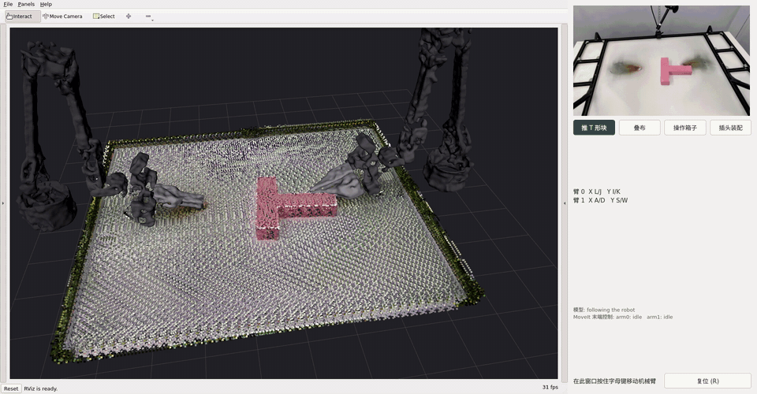
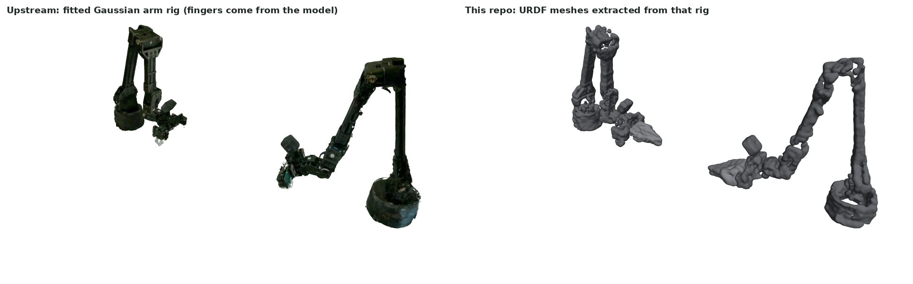
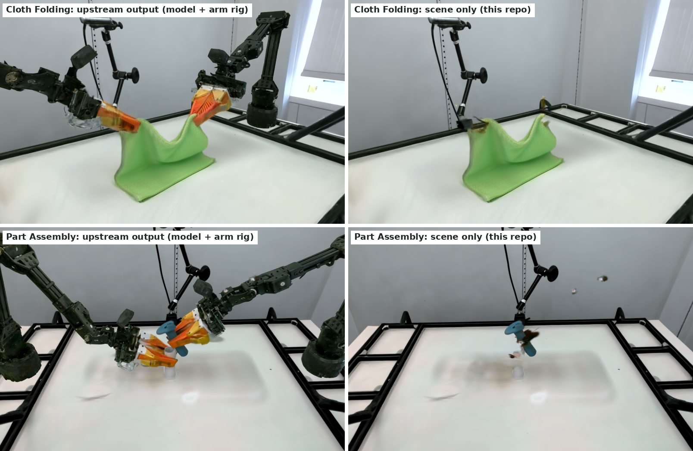
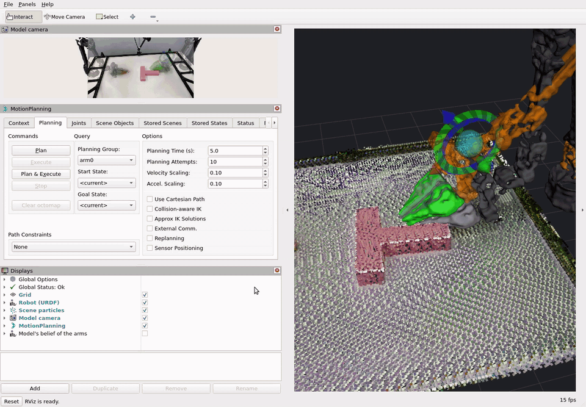
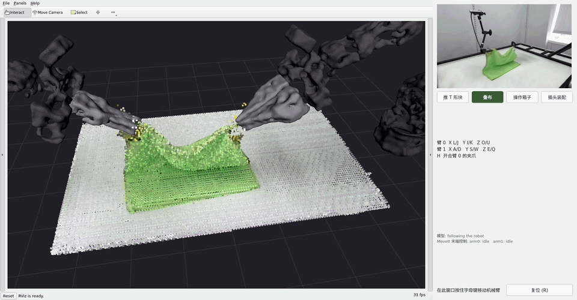
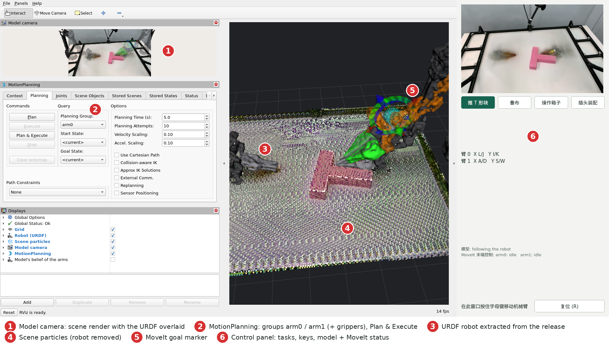

# WorldSim ROS 2：用真实机器人软件栈驱动学习式 3D 世界模型

[English](README.md)

把 **[Hybrid Particle-Voxel Dynamics for Multimodal 3D World Simulation](https://github.com/jwang771/3d-world-simulator)**（Wang 等，2026）接入
ROS 2 Humble / MoveIt 2。世界模型在一张消费级显卡上本地推理。机器人是**从发布权重中提取出的 URDF**，末端通过
**MoveIt 规划组**控制，仿真和真机共用同一套节点。



> 世界模型和权重都是原作者的成果。本仓库 fork 自 [jwang771/3d-world-simulator](https://github.com/jwang771/3d-world-simulator)：
> 顶层是他们的代码，未做改动；新增内容都在 `ros2/` 目录里。权重从他们的 Hugging Face 仓库下载（见「安装」）。

## 相比上游演示增加了什么

| | 上游交互演示 | 本仓库 |
|---|---|---|
| 机器人 | 拟合的高斯点手臂（`ArmRig`） | 从 `arms/rig.pt` 提取的 **URDF**，带网格（`tools/extract_robot.py`） |
| 场景输出 | 全部高斯点，含手臂 | **仅场景**：去掉机器人（包括被标成物体的夹爪垫），保留夹爪里拿着的物体 |
| 控制 | 键盘 / 网页 gizmo 直接改指令位姿 | **MoveIt 2 规划组** `arm0` / `arm1`（及夹爪）：键盘、位姿话题、RViz MotionPlanning |
| 动作 ↔ 机器人 | 14 维位姿向量 | URDF 上的一次 **TF 查询**（`armN_action_frame → armN_action_tcp`），用发布数据标定 |
| 接口 | 网页 | ROS 2 话题：`PointCloud2`、`Image` + `CameraInfo`、`JointState`、`FollowJointTrajectory` |
| 机器人后端 | — | 训练用机器人的运动学仿真，以及**真机后端**（示例配置：双臂人形机器人） |

## 原理

键盘、位姿话题、RViz MotionPlanning → ee_teleop / MoveIt 规划组 → FollowJointTrajectory（仿真：`sim_robot`；真机：机器人自己的控制器）
→ `/joint_states` → robot_state_publisher → TF → `world_model`（TF 末端位姿 → 14 维动作 → 模型一步）→ 场景粒子和渲染图。
测得的动作有变化时，模型才往前走一步（另有短暂续步，夹爪变化后还有沉降步），和上游演示一致。机器人不动，场景就不动。

## 结果



**提取机器人。** 运动学链取自作者从 URDF 导出的关节表（`arms/rig.pt → fk`）。每个连杆的网格由该连杆的拟合高斯点体素化后用
marching cubes 生成，碰撞体是网格的凸包。

**动作是指令位姿，不是某个连杆的位姿。** 用发布里的手臂关节头（`ArmRig.joint_net`）读出四条种子轨迹每帧的关节角，再用最小二乘
拟合每臂固定的 `action_frame`（相对 `base_link`）和 `action_tcp`（相对 `gripper_link`）。结论：

- 动作比实际手臂超前约 **2 个模型步（0.2 秒）**：它是遥操作的指令，手臂跟在后面。
- 姿态是绕**固定 x、y、z 轴**的 roll-pitch-yaw，和 ROS 一致；换成内旋 XYZ 或 zyx，旋转残差大 1.2–2.1 倍。

| 臂 | 位置中位数 | 位置 p90 | 旋转中位数 |
|---|---|---|---|
| 臂 0 | 7.1 mm | 12.5 mm | 3.0° |
| 臂 1 | 9.8 mm | 18.3 mm | 2.6° |

每臂 1,180 帧，残差和关节头本身的误差相当。URDF 加入这两个连杆后，不管关节角从哪里来，查一次 TF 就得到模型动作。



**仅场景粒子化。** 只去掉机器人类别不够：夹爪垫被标成了物体，部分手臂被标成了桌面。这里用发布里的手臂 rig 找到模型自己认为的
手臂位置，在其周围膨胀的体素范围内，去掉离开桌面的桌面类点和红/橙色夹爪垫。夹爪里拿着的物体（布、插头）保留。




**ViperX 腕部奇异点。** 在叠布工作区里把手臂往下放，`wrist_angle` 会经过 0，此时 `forearm_roll` 和 `wrist_rotate` 共轴。
MoveIt 的 KDL 和 LMA 在这里会漂成 180° 翻腕（两个关节各反向转约 π，10 cm 的移动要 2 秒，被新轨迹打断时末端还会偏离直线）；
带位移代价的 pick_ik 则卡住不动。所以仿真臂的末端流式控制改用核心库的阻尼 IK 逐 3 mm 求解（奇异点附近自适应加大阻尼，
位置权重高于姿态，姿态误差限 1.1°，小于标定本身约 3° 的误差），再交给 MoveIt 规划组做碰撞检查后执行。这样腕关节会像录制数据里
那样直接越过 0。RViz 目标标记和 OMPL 规划仍用 MoveIt 的 IK；真机用 MoveIt 的笛卡尔路径。

**保持在训练过的运动范围内。** 数据里每 0.1 秒大约移动一个键盘步长（3.5–4 mm）。绝对目标因此按每 tick 一步逼近（同上游 gizmo）。
机器人动得更快时（MoveIt 面板、真机），模型节点会把每个 tick 的运动拆成最多 4 个插值子步。

**性能**（RTX 4070 Laptop 8 GB，参考推理）：动力学一步 20–70 ms，去机器人的场景解码约 100 ms，640×400 渲染约 5 ms（预热后）。
默认每秒 5 个模型步，显存峰值约 2.6 GB；`fast:=true` 启用上游的稀疏解码和编译加速。

## 安装

测试环境：Ubuntu 22.04、ROS 2 Humble、MoveIt 2.5、Python 3.10、PyTorch（CUDA 13.0）、RTX 4070 Laptop。

```bash
sudo apt install ros-humble-moveit ros-humble-ros2-controllers python3-pyqt5

# 本 fork 的 ros2-integration 分支（顶层是上游代码，测试于上游提交 fc80d4b）
git clone -b ros2-integration https://github.com/mikeJoy6/3d-world-simulator.git
cd 3d-world-simulator/ros2

WORLDSIM_TORCH_PYTHON=/装了torch的/python tools/setup_runtime.sh   # 在现有 Python 3.10 + PyTorch 上建 .venv
python3 tools/fetch_weights.py                                      # 发布权重约 860 MB，带校验

source /opt/ros/humble/setup.bash
colcon build --base-paths src --symlink-install
```

提取出的机器人（`src/worldsim_description`）已提交在仓库里，不需要重新运行 `tools/extract_robot.py`。

## 仿真

```bash
./run_sim.sh                      # 推 T；task:=pusht|cloth|box|assembly
./run_sim.sh task:=cloth          # 叠布，H 开合夹爪
./run_sim.sh mode:=replay         # 循环回放官方动作，手臂按 IK 跟随
./run_sim.sh model_arms:=true     # 另显示模型自己认为的手臂位置
```

- **控制窗口**：按住任务按键动末端；按钮切换任务，R 复位，H 开合夹爪。按键说明取自各任务的 `task.json`。
- **RViz → MotionPlanning**：选组 `arm0`/`arm1`，拖目标标记，点 Plan & Execute；夹爪选 `arm0_gripper`/`arm1_gripper`，状态 `open`/`closed`。
- **话题**：
  - `/worldsim/armN/target_pose`（任意 TF 系下的 `PoseStamped`）
  - `/worldsim/action`（14 维绝对目标）
  - `/worldsim/key`、`/worldsim/reset`、`/worldsim/select_task`



静态插图由 `tools/render_readme_figures.py` 从模型直接渲染。用 `rviz_config:=<文件>` 可以换成自己的 RViz 布局。

## 真机

世界模型可以跟随真机末端。手臂由机器人自己的控制器、遥操作，或本仓库的键盘经**机器人自己的 MoveIt 规划组**驱动。映射是
**相对的**：启动、复位或切换任务时，机器人当前的末端位姿被绑定到种子帧动作；此后模型看到的是机器人从那一刻起的运动，
经 `axes` 旋转到模型各臂的坐标系、再乘以 `scale`。

```bash
# 先起机器人自己的栈（robot_state_publisher、move_group、手臂轨迹控制器）
ros2 launch worldsim_g2 real.launch.py task:=pusht                       # 跟随；键盘只规划
ros2 launch worldsim_g2 real.launch.py task:=pusht enable_motion:=true   # 键盘真动手臂（10% 速度）
```

示例配置 `src/worldsim_g2/config/g2.yaml` 针对一台规划组为 `left_arm_group`/`right_arm_group` 的双臂人形机器人；换机器人时改其中的坐标系、规划组和控制器名。

> **现状：** 真机路径只用模拟的 TF 测过，没有连机器人侧的 move_group。模型是在两台 ViperX 上训练的，跨本体的预测**未经验证**。

## 话题、目录、局限

话题表、目录说明和局限见英文 [README](README.md#topics)，两份内容一致。离线测试：`python3 -m pytest src/worldsim_core/test -q`。

## 致谢与引用

世界模型、手臂 rig、数据集和权重均归原作者所有。使用本仓库请引用他们的论文（BibTeX 见英文 README）。

## 许可证

<!-- TODO: 为本仓库自己的代码选一个许可证（如 MIT、Apache-2.0）并添加 LICENSE 文件 -->
`ros2/` 里的代码：待定。fork 顶层的上游代码和发布权重**不**在此许可证范围内，仍按原作者的条款（撰写时上游仓库没有许可证文件）。
