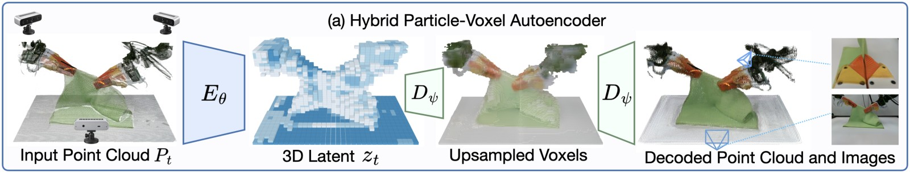
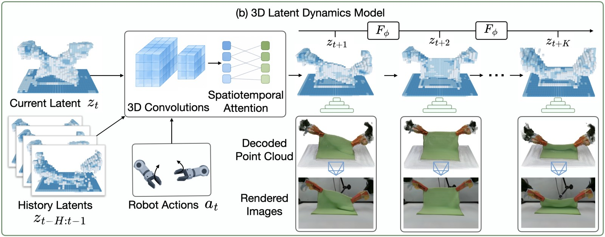
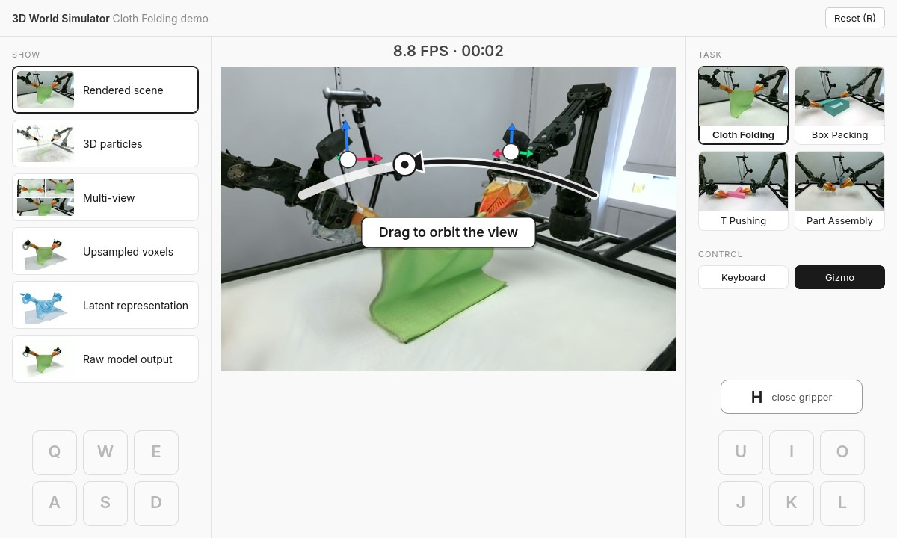

# Hybrid Particle-Voxel Dynamics for Multimodal 3D World Simulation

[Jimmy Wang](https://jwang771.github.io)<sup>1,2</sup>, [Yifan Chou](https://yifan-chou.github.io)<sup>3</sup>, [Kaifeng Zhang](https://kywind.github.io)<sup>1</sup>, [Yixuan Wang](https://www.yixuanwang.me/)<sup>4</sup>, [Binghao Huang](https://binghao-huang.github.io)<sup>1</sup>, [Tao Yu](https://www.linkedin.com/in/taoyumit)<sup>5</sup>, [Saleh Nabi](https://www.linkedin.com/in/saleh-nabi-877ba573)<sup>5</sup>, [Yunzhu Li](https://yunzhuli.github.io)<sup>1</sup>

<sup>1</sup>Columbia University, <sup>2</sup>UC Berkeley, <sup>3</sup>University of Michigan, <sup>4</sup>NVIDIA, <sup>5</sup>Analog Devices

[Project website](https://jwang771.github.io/3dworldsimulator/) | [arXiv](https://arxiv.org/abs/2611.04492) | [Data and checkpoints](https://huggingface.co/datasets/jwang771/3d-world-simulator) | [Interactive demo](https://jwang771.github.io/3dworldsimulator/#demo)




## Install

```bash
conda env create -f environment.yml
conda activate 3dws
```

Data and checkpoints are in one Hugging Face repository,
[`jwang771/3d-world-simulator`](https://huggingface.co/datasets/jwang771/3d-world-simulator).

## Interactive demo

```bash
hf download jwang771/3d-world-simulator --repo-type dataset --include "checkpoints/*" --local-dir hub
python -m demo.server_fast --release hub/checkpoints
```

Open `http://localhost:8000`. Pick a task (cloth, box, T pushing, part assembly) and drive the arms with the gizmo or
the keyboard. It runs at 35 to 50 FPS; the first load compiles for about a minute.



## Download data

Processed data of a task (`cloth`, `box`, `pusht` or `assembly`), ready for training:

```bash
hf download jwang771/3d-world-simulator --repo-type dataset --include "data/processed/assembly/*" --local-dir hub
mkdir -p data && ln -s $PWD/hub/data/processed/assembly data/assembly
python scripts/link_splits.py data/assembly
```

## Autoencoder training

```bash
python scripts/train_vae.py --task assembly --data-root data --out-dir runs/assembly/vae
```

`--task` is one of `cloth`, `box`, `pusht`, `assembly`; each task has a specific set of parameters in
`tasks.py`, including voxel grid dimensions, workspace bounds, whether it has tactile sensing, among other information.
We also include the ability to place object-specific weights during training, which improves the simulation fidelity.

`--recipe minimal` trains without any extra weighting. The default, `--recipe full`, adds the object weights, the robot
and gripper voxel labels and the tactile targets, and is what the released models were trained with.

## Dynamics training

Dynamics model training is much faster after precomputing latents. To precompute the latents, run the following:

```bash
python scripts/export_latents.py --vae-ckpt runs/assembly/vae/checkpoints/latest.pth \
  --packed-dir data/assembly/train --out-dir runs/assembly/latents/train
python scripts/export_latents.py --vae-ckpt runs/assembly/vae/checkpoints/latest.pth \
  --packed-dir data/assembly/val --out-dir runs/assembly/latents/val
```

Then train the dynamics model:

```bash
L=runs/assembly/latents
python scripts/train_dynamics.py --latent-dir $L/train --val-latent-dir $L/val --out-dir runs/assembly/dynamics \
  --n-history 8 --ar-schedule 1 2 3 4 5 6 7 8 9 10 --ar-schedule-epochs 50 100 150 200 250 300 350 400 450 500
```

The model predicts the next latent from the last `--n-history` latents and actions. We find that having a schedule
`ar-schedule` and training using predicted latents in the history dramatically improve the performance of the model.

## Visualization

Viser viewers for the downloaded data. They read the processed episodes directly, and each has an episode slider and a
frame slider:

```bash
./pw camera assembly     # fused point cloud, camera poses and workspace box (port 8099)
./pw voxels assembly     # the same with the occupied voxels at a chosen grid resolution (port 8097)
./pw cams   assembly     # the same with every camera image, wrist cameras included (port 8095)
```

Each prints its address; open `http://localhost:<port>`.

## Deform360

The Deform360 dynamics model draws the gripper into the voxel grid instead of using a plain action vector, and trains
only on frames where the gripper is closed (the object does not move while it is open, so a model trained on all frames
learns to copy the last frame). See the docstrings in [deform360/](deform360/).

```bash
python -m deform360.prepare --latents latents/train --raw <deform360 recordings> --out segments/train
python -m deform360.prepare --latents latents/val   --raw <deform360 recordings> --out segments/val
python -m deform360.train --latent-dir segments/train --val-latent-dir segments/val --out-dir runs/deform360/dynamics
```

## More

- [docs/guide.md](docs/guide.md): the full walkthrough, including processing your own recordings, rollout videos, demo controls, the kinematic robot arms and the Python API
- [docs/data.md](docs/data.md), [docs/data_format.md](docs/data_format.md): what is on the Hub and the episode format
- [processing/README.md](processing/README.md): raw recordings to training files

## Citation

```bibtex
@article{wang2026hybrid,
  title   = {Hybrid Particle-Voxel Dynamics for Multimodal 3D World Simulation},
  author  = {Wang, Jimmy and Chou, Yifan and Zhang, Kaifeng and Wang, Yixuan and Huang, Binghao and Yu, Tao and Nabi, Saleh and Li, Yunzhu},
  journal = {arXiv preprint arXiv:2611.04492},
  year    = {2026}
}
```
