# Hybrid Particle-Voxel Dynamics for Multimodal 3D World Simulation

[Jimmy Wang](https://jwang771.github.io)<sup>1,2</sup>, [Yifan Chou](https://yifan-chou.github.io)<sup>3</sup>, [Kaifeng Zhang](https://kywind.github.io)<sup>1</sup>, [Yixuan Wang](https://www.yixuanwang.me/)<sup>4</sup>, [Binghao Huang](https://binghao-huang.github.io)<sup>1</sup>, [Tao Yu](https://www.linkedin.com/in/taoyumit)<sup>5</sup>, [Saleh Nabi](https://www.linkedin.com/in/saleh-nabi-877ba573)<sup>5</sup>, [Yunzhu Li](https://yunzhuli.github.io)<sup>1</sup>

<sup>1</sup>Columbia University, <sup>2</sup>UC Berkeley, <sup>3</sup>University of Michigan, <sup>4</sup>NVIDIA, <sup>5</sup>Analog Devices

[Project website](https://jwang771.github.io/3dworldsimulator/) | [arXiv](https://arxiv.org/abs/2611.04492) | [Interactive demo](https://jwang771.github.io/3dworldsimulator/#demo)

3D World Simulator learns the dynamics of a robot workspace directly in 3D. A hybrid particle-voxel autoencoder turns the
point clouds of a few depth cameras into a voxel grid of latents, an action-conditioned 3D U-Net predicts how those
latents evolve, and a Gaussian-splat head renders any latent from any viewpoint at 50+ FPS.

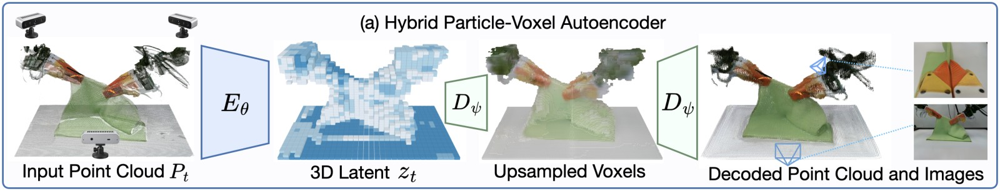
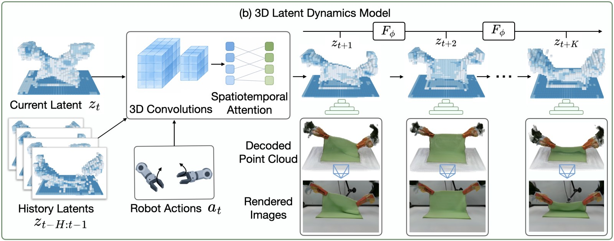

This README walks through the whole pipeline in order. Every step names the command, what it reads and writes, and how
to look at the result.

| step | what you do | command | result |
|---|---|---|---|
| 0 | install | `conda env create -f environment.yml` | the `3dws` environment |
| 1 | get data | `hf download ...` or your own recordings | `raw/<dataset>/` and/or `data/<dataset>/` |
| 2 | stereo depth and object masks | `processing.fs_stereo.run_fs`, `processing.sam3.segment_all` | `raw/<dataset>/fs_disp/`, `sam3_masks/` |
| 3 | calibrate and inspect in the browser | `./pw camera`, `crop`, `voxels`, `cams` | `config.json`, `cam_crops.json` |
| 4 | pack into training files | `./pw pack`, `./pw tablebbox` | `data/<dataset>/packed/`, `train/`, `val/` |
| 5 | train the autoencoder | `scripts/train_vae.py` | `runs/<task>/vae/` |
| 6 | precompute latents | `scripts/export_latents.py` | `runs/<task>/latents/` |
| 7 | train the dynamics | `scripts/train_dynamics.py` | `runs/<task>/dynamics/` |
| 8 | roll out and render, interactive demo | `scripts/rollout.py`, `demo/server.py`, `models/world_model.py` | videos, images, metrics, the demo in your browser |
| 9 | check, release, upload | `tests/`, `scripts/export_release.py`, `scripts/hf_upload.sh` | `release/`, Hub repositories |

**Shortcuts.** To only run the released models, do step 0 and jump to [step 8](#step-8-roll-out-and-render). To train on
the published processed data, do steps 0 and 1 and jump to [step 5](#step-5-train-the-hybrid-particle-voxel-autoencoder).
Steps 2 to 4 are only needed for new recordings or to re-process the raw data.

## Step 0. Install

```bash
conda env create -f environment.yml
conda activate 3dws
```

`spconv` ships CUDA 12.6 wheels; on Blackwell GPUs (sm_120) build it from source with `env/build_spconv.sh`. Every
command below runs from the repository root.

## Step 1. Get the data

There are two kinds of data, and two folders in the repository root (both git-ignored):

```
raw/<dataset>/episode_<E>.hdf5        recorded episodes: colour and stereo IR images of 5 cameras, actions, joints, tactile pads
data/<dataset>/packed/episode_<E>.hdf5   processed episodes: point clouds, depth, masks, render targets, labels, actions
```

Training reads the packed episodes and nothing else: one self-contained file per episode. Stereo disparity (`fs_disp/`),
object masks (`sam3_masks/`) and the label folders are intermediate products of the processing steps below.

```
```

Everything is in one Hugging Face dataset repository,
[`jwang771/3d-world-simulator`](https://huggingface.co/datasets/jwang771/3d-world-simulator), as plain files:
`data/processed/<dataset>/`, `data/raw/<dataset>/` and `checkpoints/`. [docs/data.md](data.md) describes them.

```bash
# processed data of one task (enough for steps 5 to 8)
hf download jwang771/3d-world-simulator --repo-type dataset --include "data/processed/assembly/*" --local-dir hub
mkdir -p data && ln -s $PWD/hub/data/processed/assembly data/assembly
python scripts/link_splits.py data/assembly     # makes train/ and val/ from splits.json
# raw recordings of the same task (only for steps 2 to 4)
hf download jwang771/3d-world-simulator --repo-type dataset --include "data/raw/assembly/*" --local-dir hub
mkdir -p raw && ln -s $PWD/hub/data/raw/assembly raw/assembly
```

| task and dataset | episodes (train / val) | what happens |
|---|---|---|
| `cloth` | 210 (200 / 10) | two arms fold and drop a cloth; tactile pads |
| `box` | 112 (102 / 10) | pushing and rotating a box |
| `pusht` | 210 (200 / 10) | pushing a T block |
| `assembly` | 210 (200 / 10) | inserting a plug into a socket; tactile pads |

For your own recordings, put the episodes in `raw/<dataset>/` in the format of
[processing/README.md](../processing/README.md#data-contract) and continue with step 2. If the data lives elsewhere, set
`ADATA` (raw root) and `APROC` (processed root) instead of using `raw/` and `data/`.

## Step 2. Stereo depth and object masks

Two GPU jobs turn the recorded images into geometry and labels. They need the
[FoundationStereo](https://github.com/NVlabs/FoundationStereo) and SAM3 checkouts (`FS_REPO`, `SAM3_REPO`, default
`external/`).

```bash
# depth: disparity for the left and the right IR image of every camera, about 0.4 to 0.9 s per image
python -m processing.fs_stereo.run_fs --dataset <dataset> --pair both --skip-existing
# masks: the manipulated object in every camera, from a text prompt, about 5 minutes per episode
python -m processing.sam3.segment_all --dataset <dataset> --prompt "green cloth" --cams 0,1,2,3,4
```

Results: `raw/<dataset>/fs_disp/disp_episode_<E>.hdf5` and `raw/<dataset>/sam3_masks/episode_<E>_camera_<C>.h5`. Both
disparity sides are needed, because the packer keeps only the pixels where left and right agree. Prompts that worked:
`"green cloth"`, `"teal box"`.

## Step 3. Calibrate and inspect in the browser

`./pw` is the driver for everything between raw episodes and training files. Each viewer is a small web server: run the
command, open the printed address (`http://localhost:<port>`; over ssh add `-L <port>:localhost:<port>`), look, adjust,
save. `PORT=...` changes the port.

```bash
./pw setup  <dataset>     # creates data/<dataset>/, links raw data, copies starting JSONs from $TEMPLATE
./pw status <dataset>     # counts: raw episodes, depth, masks, packed, train/val, what is missing
```

### 3a. `./pw camera <dataset> [episode]`: camera poses and the workspace box (port 8099)

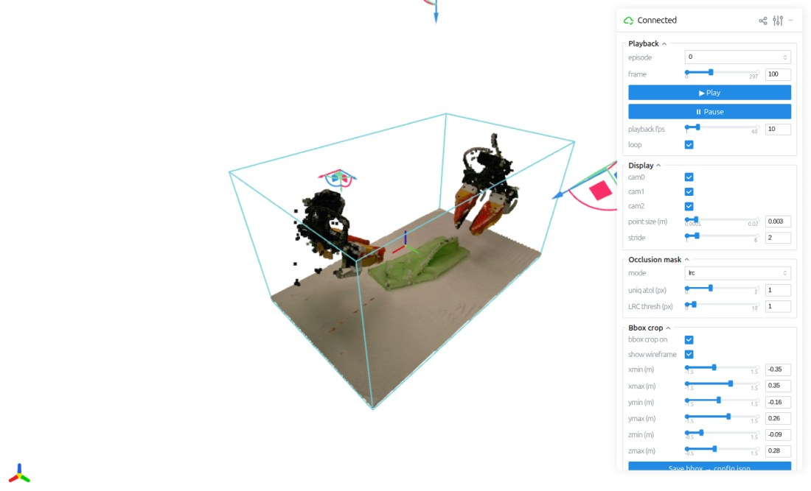

The depth of the fixed cameras is lifted to one coloured point cloud. If the calibration is right the clouds of the three
cameras coincide: one table plane, one copy of every gripper. Drag a camera's gizmo (or use its sliders) until they do.
The cyan box is the workspace: everything outside is discarded, so make it just contain the table area, the object and
the grippers. Play the episode to check that nothing leaves the box. **Save** writes the camera corrections and the box
to `data/<dataset>/config.json` (the previous file is archived).

### 3b. `./pw crop <dataset>`: image crops (port 8093)

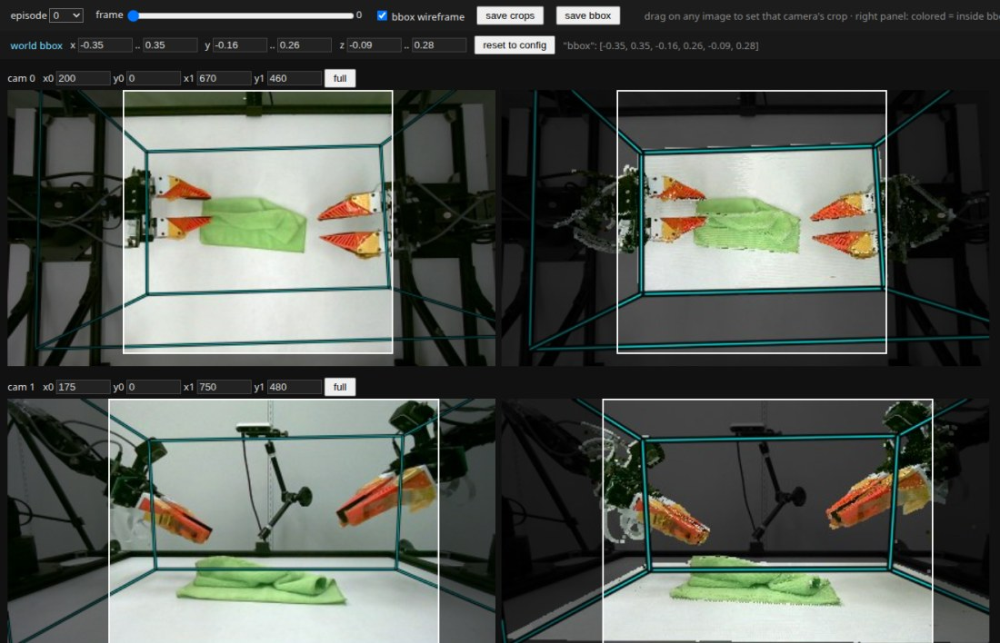

Left column: the colour image of each camera with the workspace box drawn in. Right column: the same image with the
pixels inside the box in colour. Drag a rectangle on an image to set that camera's crop: this is the image the
autoencoder is trained to render, so it should cover the workspace and little else. **save crops** writes
`cam_crops.json`; the box can also be edited here (**save bbox**).

### 3c. `./pw voxels <dataset> [episode]`: the voxel grid (port 8097)

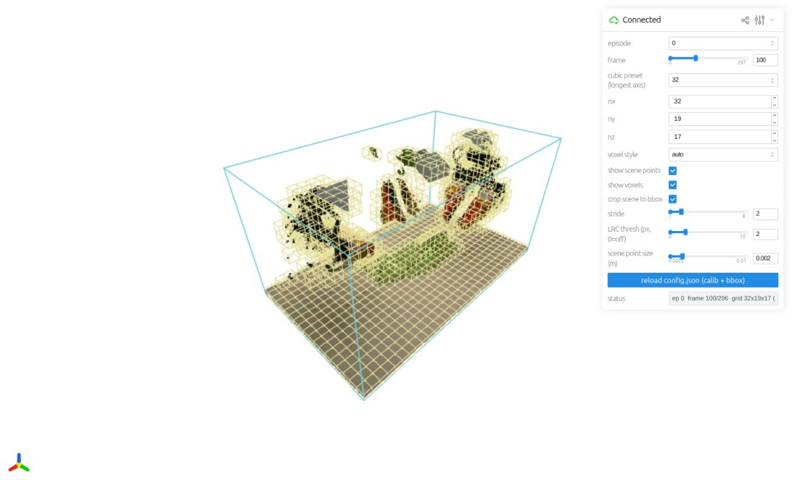

The fused cloud with the occupied cells of a voxel grid on top, at a resolution you choose (`nx`, `ny`, `nz`). Use it
to choose the grid of a new task in `tasks.py`: cells should be small enough to separate the object from the grippers.
Nothing is saved.

### 3d. `./pw cams <dataset> [episode]`: all cameras, frame by frame (port 8095)

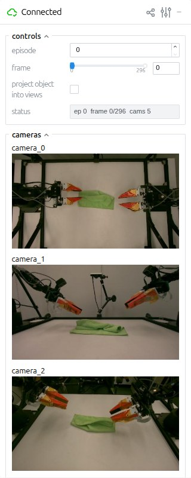

Every camera image of a frame, including the moving wrist cameras. Tick **project object into views** to draw the
object's points through each camera's pose: if the overlay sits on the object in the wrist images, the per-frame wrist
poses are good. Nothing is saved.

## Step 4. Pack into training files

```bash
LRC=2 ./pw pack <dataset>
```

This runs four stages and skips whatever is already done:

1. **pack**: for every frame and camera, depth from disparity, keep pixels that pass the left-right check (`LRC` pixels),
   the depth range and the workspace box; store depth, aligned colour, the object label and the masks.
2. **outlier mask**: statistical outlier removal on the fused cloud (10 neighbours, 2 standard deviations).
3. **render targets**: the cropped colour image, intrinsics and pose of every camera, per frame.
4. **split**: `train/` and `val/` as links into `packed/` (validation = episode ids ending in 9; override with `VAL_EPS`).

One camera (camera 2 by default, `BLACKOUT`) sees the room behind the table. The first time, `pack` stops before stage 3 and asks for the table box:

```bash
./pw tablebbox <dataset>      # port 8091
```

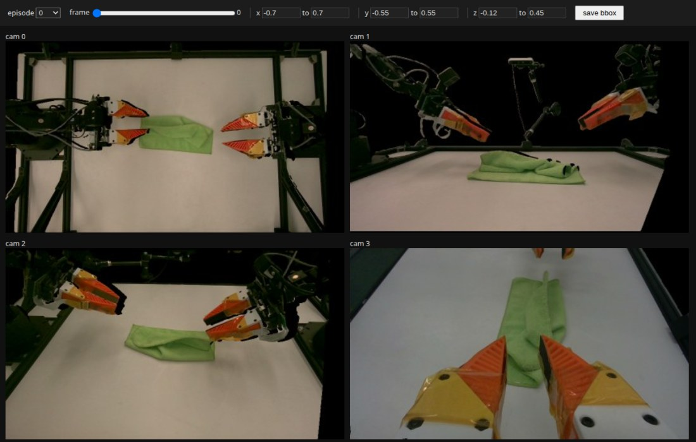

Pixels whose 3D point lies outside this box are blacked out in the render targets, so the model is not asked to render
the room. Adjust the `x`, `y`, `z` limits until the background is black and the table, object and arms are untouched,
**save bbox** (writes `table_bbox.json`), and run `./pw pack <dataset>` again.

The robot and gripper labels (`robot_label_cache/`, `gripper_supervision/`, `cam_perframe/`, `tactile_targets/`) come
from a fitted Gaussian-splat model of the arms that is not part of this release; the published processed datasets include
them. With those in place:

```bash
python -m scripts.bake_gripper_halo --root data/<dataset>      # gripper region for the render loss
python -m scripts.preflight_labels  --root data/<dataset>      # fails if any episode misses a label file
./pw status <dataset>
```

The last step makes every episode self-contained. It writes a new `packed/` folder in which each episode also holds the
final object masks, the gripper masks, the robot voxel labels and the tactile targets, with its depth maps stored as
lossless video (`h5video.py`, about 70 % of the size, bit-exact):

```bash
python scripts/consolidate_packed.py --root data/<dataset> --out data_final/<dataset>/packed --workers 8
```

`data_final/<dataset>` with a `splits.json` is then a complete training dataset. Label folders that do not exist are
skipped, and such episodes train with the minimal recipe of step 5.

The packed format is documented field by field in [docs/data_format.md](data_format.md); the options of every stage
are in [processing/README.md](../processing/README.md).

## Step 5. Train the hybrid particle-voxel autoencoder

Each task's datasets, voxel grid and workspace bounds are in `tasks.py`.

```bash
python scripts/train_vae.py --task assembly --data-root data --out-dir runs/assembly/vae
```

`--task` is one of `cloth`, `box`, `pusht`, `assembly`; each task has a specific set of parameters in
`tasks.py`, including voxel grid dimensions, workspace bounds, whether it has tactile sensing, among other information.
We also include the ability to place object-specific weights during training, which improves the simulation fidelity.

### Two recipes: minimal and full

`--recipe` chooses which labels of the packed episode are used and which loss terms are on. Both read the packed episodes
only.

| | `--recipe minimal` | `--recipe full` (default, the released models) |
|---|---|---|
| needs in the episode | points, depth, images, object masks: what `./pw pack` writes | also `labels/` (robot and gripper voxels), `render/*/gripper_mask` and `tactile_targets/`, added by `consolidate_packed.py` |
| extra weighting | none | the manipulated object (9x in the voxel losses, in the Chamfer loss and in a band around it in the images) and the gripper (19x in the voxel losses, 20x in the Chamfer and image losses, plus an LPIPS term on gripper crops) |
| classes | object and scene; the robot class is trained to stay empty | object, robot and scene, from the robot voxel labels |
| tactile | not predicted | tactile cells and signals, for the tasks that have them |

```bash
python scripts/train_vae.py --task assembly --data-root data --out-dir runs/assembly/vae --recipe minimal    # packed episodes only
python scripts/train_vae.py --task assembly --data-root data --out-dir runs/assembly/vae                     # full
```

The loss terms common to both recipes are: occupancy and colour per voxel at every level, the object class, the
consistency of the latent under point subsampling, the Chamfer distance between the Gaussians and the point cloud, the
image loss (L1, SSIM, LPIPS), the rendered-depth loss and the free-space carving loss. The full recipe is an extension of
the minimal one: it adds the object and gripper weighting, the robot class and the tactile heads, and needs the label folders that
come from the fitted arm model (see step 4). Start with the minimal recipe for a new task or a new robot, where those
labels do not exist. Steps 6 to 8 are the same for both; a checkpoint records its recipe.

The depth targets of both recipes are the depth maps of the packed episode. The released checkpoints were trained with
depth recomputed from the stereo disparity with a looser left-right check (8 px instead of the 2 px used at packing), which
keeps 1 to 4 % more pixels; the values agree within a millimetre.

The autoencoder is a sparse 3D encoder over the fused point cloud (positions and colours, normalised by `norm_params.npz`)
into an 8-channel latent grid at the task's resolution (for example 64 x 32 x 64 cells over a 0.7 x 0.4 x 0.4 m workspace
for cloth), and a dense decoder that upsamples it twice and predicts, per cell, occupancy, colour, a robot label, an object
label and, for tactile tasks, the tactile cells and signals. On the occupied cells of the finest level a Gaussian head
(`models/big_head.py`) emits 16 anisotropic Gaussians per cell, rendered with gsplat against the real camera images; the
render loss (L1, SSIM and LPIPS) is what makes the rendered scene sharp. `--phase-a` and `--phase-b` set how many epochs
run before the Gaussian head joins and how many train the head alone; `--wrist-start` is the epoch at which the moving
wrist cameras enter the render loss; `--bg-init-eps` is how many episodes seed the learned background; `--iters` and
`--val-iters` are the iterations per epoch. Checkpoints go to `runs/assembly/vae/checkpoints/` every `--save-interval` epochs
and `--resume` continues from one.

While it runs, every epoch prints one line (`[ep 12] train 21.4 val 19.8 lr 2.0e-04`) and appends it to
`runs/assembly/vae/metrics.jsonl`; `checkpoints/latest.pth` is always the last epoch and `best.pth` the lowest validation loss.
A task with several datasets trains on all of them; `--datasets` restricts it to the ones you have.

## Step 6. Precompute the latents

Dynamics model training is much faster after precomputing latents. To precompute the latents, run the following:

```bash
python scripts/export_latents.py --vae-ckpt runs/assembly/vae/checkpoints/latest.pth \
  --packed-dir data/assembly/train --out-dir runs/assembly/latents/train
python scripts/export_latents.py --vae-ckpt runs/assembly/vae/checkpoints/latest.pth \
  --packed-dir data/assembly/val --out-dir runs/assembly/latents/val
```

One file per episode holds the latents of every frame in a compact form (only the cells that differ from the empty
vector), the recorded actions, the object and tactile cells used to weight the dynamics loss, and the camera parameters.
`--episodes` selects a subset and `--epid-offset` shifts episode ids so that several datasets of one task can share one
latent folder (for example `--epid-offset 1000` for the second dataset of the box task).

## Step 7. Train the 3D latent dynamics

```bash
L=runs/assembly/latents
python scripts/train_dynamics.py --latent-dir $L/train --val-latent-dir $L/val --out-dir runs/assembly/dynamics \
  --n-history 8 --ar-schedule 1 2 3 4 5 6 7 8 9 10 --ar-schedule-epochs 50 100 150 200 250 300 350 400 450 500
```

The model predicts the next latent from the last `--n-history` latents and actions. We find that having a schedule
`ar-schedule` and training using predicted latents in the history dramatically improve the performance of the model.

The predictor is a 3D U-Net (`models/dynamics_coarse3d.py`) over the history frames stacked in channels, with causal
attention over time at the coarsest level and action-keyed FiLM modulation in every block. `--ar-schedule` with
`--ar-schedule-epochs` is the curriculum: during the first 50 epochs the model is trained to predict one step ahead, then
its own predictions are fed back as history for 2, 3, ... 10 steps, so that at inference long rollouts stay on the data
manifold. Actions are normalised with the mean and standard deviation of the training set (`action_norm_params.npz`,
written next to the checkpoints and needed at inference). `--object-alpha` and `--tactile-alpha` weight the loss on the
object and tactile cells (20x by default) so the dynamics of the manipulated object dominate over the static table;
`--batch-size`, `--iters`, `--lr` and `--save-interval` are the usual knobs, `--resume` continues a run and `--init`
starts a new schedule from the weights of an earlier one (fine-tuning on additional data).

Every epoch prints `[ep 120] ar 3 train 0.0021 val 0.0019`: the number of fed-back steps of the curriculum, and the latent
error on training and validation episodes. Checkpoints are `checkpoints/latest.pth`, `best.pth` and `model_<epoch>.pth`.
To look at a model while it trains, build a task folder from any checkpoint and roll it out (step 8):

```bash
python scripts/export_release.py --out runs/assembly/task --run runs/assembly/vae/checkpoints/latest.pth \
  runs/assembly/dynamics/checkpoints/latest.pth runs/assembly/latents/val/episode_9_latents.h5 data/assembly/val/episode_9.hdf5
python scripts/rollout.py --task runs/assembly/task --steps 100 --view cams --compare --out out/assembly_val9.mp4
```

This renders the prediction above the recorded scene from the dataset cameras, on a white background (the scanned room
of the released models is a separate asset), and writes the latent error per step.

## Step 8. Roll out and render

`scripts/rollout.py` seeds the model with the history of latents and actions at a start frame, feeds actions one by one,
and renders every predicted latent to a video (plus the first frame as a PNG).

The checkpoints of the four tasks on the website are in the `checkpoints/` folder of the same repository:

```bash
hf download jwang771/3d-world-simulator --repo-type dataset --include "checkpoints/*" --local-dir hub
ln -s $PWD/hub/checkpoints release
python scripts/rollout.py --task release/cloth --steps 80 --out out/cloth.mp4
```

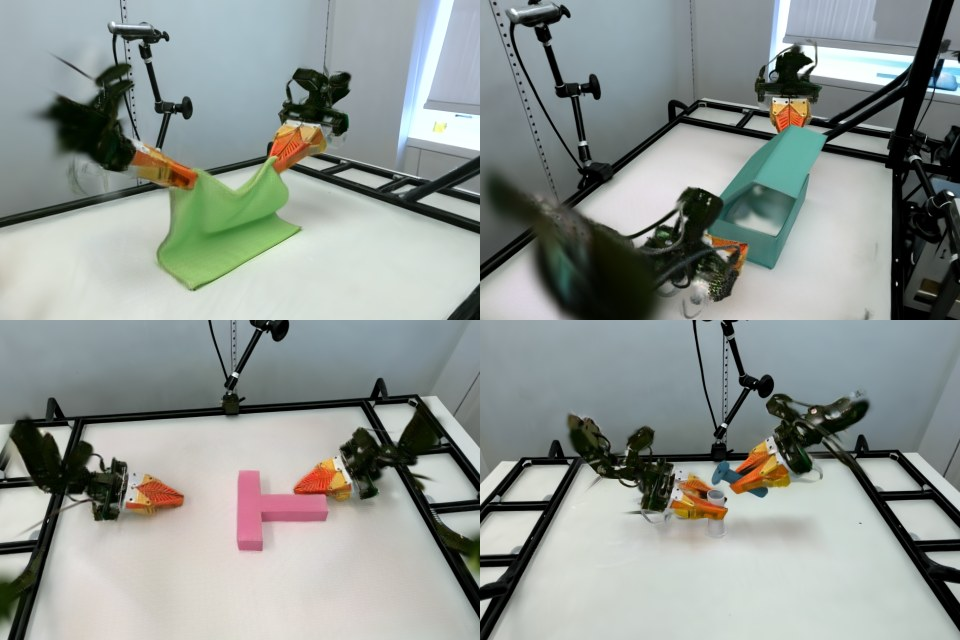

```
release/
  background/scan_room.pt     the scanned room as a Gaussian splat, in the world frame (shared)
  cloth/ box/ pusht/ assembly/
    vae.pth                   autoencoder (decoder, Gaussian head, tactile particle head where the task has tactile pads, learned camera colour map)
    dynamics.pth              latent dynamics model and action normalisation
    seed_episode_<E>.h5       one latent episode with its recorded actions, dataset cameras and some camera images
    task.json                 start frame, workspace, control step, default view, display settings
    arms.pt                   kinematic robot model of this task: arm base frames, its two networks, settings
  arms/rig.pt                 the two arms as Gaussian splats per robot link, and the forward-kinematics tables (shared)
```

| option | meaning |
|---|---|
| `--actions replay` (default) | the episode's recorded actions, open loop: the check that the model follows real commands |
| `--actions hold` | repeat the action at the seed frame (the scene settles) |
| `--actions file.npy` | your own actions, shape (steps, 14): per arm x y z, roll pitch yaw, gripper |
| `--view orbit --az -129 --el 17 --radius 0.74` | a free camera around the scene (defaults from `task.json`) |
| `--view cams --cams 0,1,2` | the dataset's cameras, as during training |
| `--mode splats` / `--mode particles` | the rendered scene / the occupied cells of the finest decoder level |
| `--compare` | the ground-truth latent rendered with the prediction (below it with several cameras), and `*.metrics.json` with the latent error per step |
| `--bf16` | bf16 decoder, head and dynamics, what the public demo runs (about 1 dB from fp32) |
| `--frame F`, `--episode other_latents.h5` | start somewhere else, or from any file written by `scripts/export_latents.py` |

`--mode splats` and `--mode particles` of the same latent:

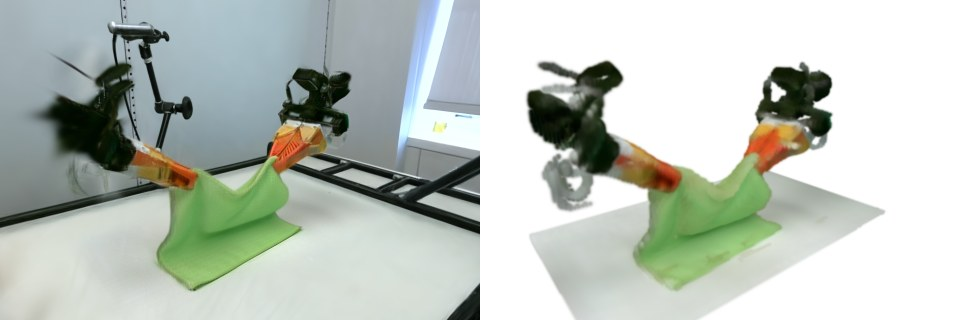

`--view cams --cams 0,1,2 --compare` after 35 open-loop steps, prediction on top, recorded scene below:

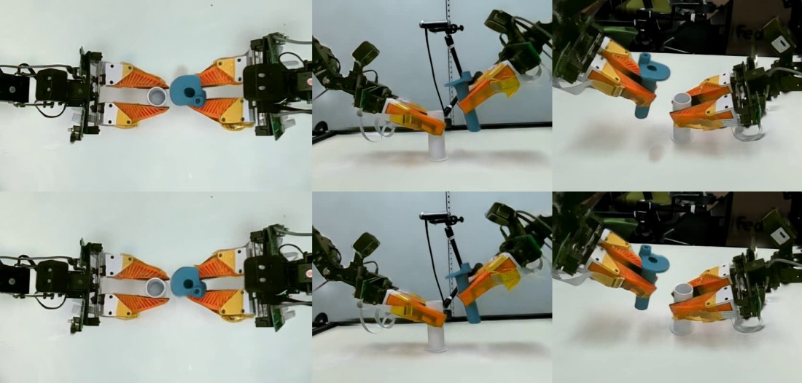

The same model from Python:

```python
from models.world_model import WorldModel
wm = WorldModel("release/box")
z, act = wm.load_episode()                      # latents (T, C, nz, ny, nx) and recorded actions (T, 14)
state = wm.seed(z, act, frame=9)                # the model's history: n_history latents and actions
cam = wm.orbit_camera(az=-157, el=31.8, radius=0.74)
for a in act[state.t : state.t + 50]:
    z_next = wm.step(state, a)                  # one dynamics step (10 Hz, one recorded action)
    image = wm.render(wm.decode(z_next), *cam)  # Gaussians of the latent, composited over the scanned room
```

An action is the commanded end-effector pose of each arm, in metres and radians, in the dataset's world frame, plus the
gripper command; the workspace limits and the per-key step of the interactive demo are in `task.json` (`workspace`,
`control`). The interactive demo on the website is this model with a keyboard and gizmo front end, the kinematic robot
model below drawn in place of the model's own arms, and TensorRT engines for speed.

The kinematic robot model (`models/arm_rig.py`) is optional in your own code. `wm.decode(z)` returns the model's own
Gaussians, arms included; with an arm state the arms are drawn from the fitted splat model instead:

```python
arms = wm.arms.new_state()                      # one per rollout; decode the frames in order (the joints are filtered)
image = wm.render(wm.decode(z_next, arms=arms), *cam)
```

To roll out a model you trained, build its task folder as shown at the end of step 7; `--episode` then starts from any
other latent file of step 6.

### Interactive demo

The demo of the website runs locally from the same `release/` folder, with the same page: pick a task, drive the arms.

```bash
python -m demo.server_fast --release release      # optimised inference, 35 to 50 FPS with the kinematic arms
python -m demo.server      --release release      # reference inference (plain fp32 PyTorch), about 12 to 25 FPS
```

Open `http://localhost:8000` (`--port` changes it; over ssh add `-L 8000:localhost:8000`). A task loads the first time it
is opened; with `server_fast` the very first load also compiles for about a minute.

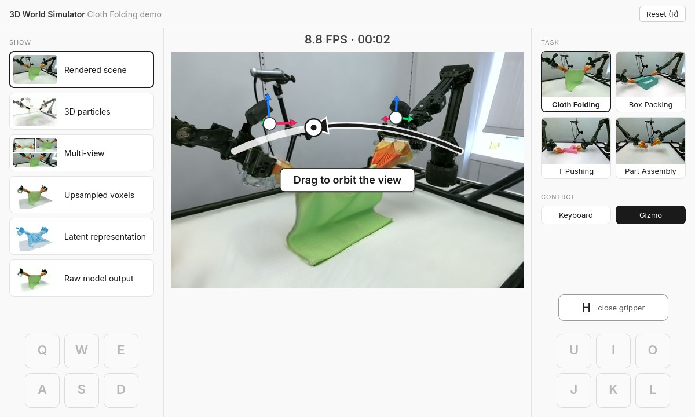

| control | what it does |
|---|---|
| **Gizmo** (default) | drag the white dot on a gripper to move that arm in the plane facing you; drag an arrow to move along one axis (red x, green y, blue z of the arm's base frame) |
| **Keyboard** | hold the keys shown under each rail: `Q W E / A S D` for the left arm, `U I O / J K L` for the right arm; keys a task does not use are greyed |
| `H` or the gripper button | open or close the gripper (cloth) |
| drag the scene, wheel, shift-drag | orbit, zoom, pan the camera |
| `R` or **Reset** | back to the start frame |
| **Show** tiles | rendered scene, 3D particles (with the tactile particles in fire colours on cloth and part assembly), the dataset cameras, upsampled voxels, the latent grid, the model's own Gaussians alone on white (no kinematic arms) |
| **Task** tiles | switch between cloth, box, T pushing and part assembly |

Every move is the dataset's own action: one recorded keyboard step per model step (4 mm, or 3.5 mm for T pushing and part
assembly), clamped to the recorded workspace, with the orientation rule of that task. The model only steps while something
is commanded, so the FPS counter holds its last value when the scene is still.

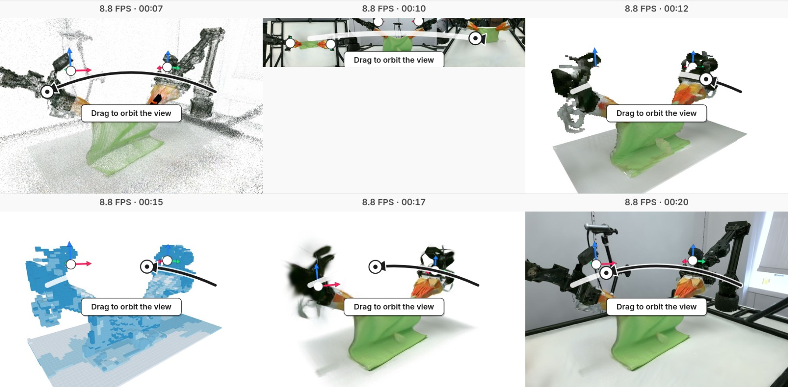

**The robot arms.** The world model predicts the arms as part of the scene, but soft. As on the website, the demo draws
them with a kinematic robot model instead: `ArmRig` in `models/arm_rig.py`, a Gaussian-splat model of the two ViperX 300 S
arms with one set of Gaussians per robot link. It is one component with one call per frame, which takes the decoder's
features of the current latent and the world model's Gaussians and returns the posed arm Gaussians. Nothing else goes in:
the commanded action is never used to pose the arms. Inside, two small networks run one after the other:

1. **Where the arms are.** A 3D convolutional network on the decoder's coarse features gives six joint angles and the
   finger opening per arm. A one-euro filter with a deadband steadies them, and an arm whose command did not change in a
   tick holds its joints.
2. **Snap to the gripper.** Forward kinematics places the rig at those joints. A PointNet then looks at the world model's
   robot Gaussians around each rig gripper and gives the small rigid correction that puts the rig's gripper exactly on
   the predicted one; the correction fades out up the forearm.

The world model then keeps only its own gripper Gaussians, inside a box around the fingers, where the contact with the
scene happens; the rig draws the rest of the arm and hides its own splats inside that box. The gizmo sits on the rig's
gripper body.

The arm files are about 120 MB of the download (`release/arms/rig.pt` and one `arms.pt` per task). `--no-arms` on either
server shows the world model's own arms; the demo also falls back to that when `release/arms` is missing.

The two servers differ only in inference speed (`demo/server_fast.py` lists what is switched on): bf16, the finest decoder
level evaluated only near the surface (`models/sparse_decoder.py`), compiled dynamics and the arm model's first network compiled. Both draw
the arms. `WorldModel(task, fast=True)` gives the same speed-up in your own code. The public demo additionally runs
TensorRT engines, which are not part of this repository. `tests/golden_arms.py` is the authors' comparison against the
public demo's code on the same latents, for every task and each of the six **Show** tiles: the arm pose is identical, the
arm Gaussians are within 0.6 mm, and every tile renders at 46 dB or better in reference mode and 35 dB or better in
optimised mode (the public code's own reference and optimised modes differ by more). With the Gaussian head in bf16, as the
public demo runs it, pose, lock and arm Gaussians are bit-identical and every tile is at 59 dB or better.

## Step 9. Check, release, upload

```bash
WS_ROOT=... python scripts/export_release.py --out release   # strips checkpoints, packs one seed episode per task, writes task.json
RELEASE_DIR=release pytest -s tests/test_release.py   # every task folder: render, rollout, views
HF_TOKEN=... scripts/hf_upload.sh release jwang771/3d-world-simulator checkpoints      # token only in the environment
```

`scripts/export_release.py` also runs `scripts/export_arms.py`, which bakes the kinematic robot model with the public demo's
own code (`--no-arms` skips it). `scripts/export_release.py` has a table at the top with, per task, the autoencoder and dynamics checkpoints, the seed
episode and the display settings. It holds the paths of the runs behind the public demo, relative to `WS_ROOT`; for your own runs use `--run` (end of step 7). The tests render the seed frame from the dataset cameras and
compare it with the real images (17 to 25 dB PSNR on the released checkpoints), roll the model 20 steps open loop and
compare the predicted latents with the recorded ones (about 6x below a frozen seed), render the orbit and particle
views, drive the demo's control and its six views without a browser, compare the optimised render with the reference, and
check the kinematic arms (pose from the latent, snap onto the predicted gripper, hand-over at the grippers, held joints). Uploads resume when re-run; see [docs/data.md](data.md).

## Repository map

| path | content |
|---|---|
| `pw`, `processing/` | data pipeline: stereo depth, masks, calibration viewers, packing, split |
| `tasks.py` | per task: datasets, voxel grid, workspace bounds, wrist cameras, tactile |
| `datasets/` | loaders for packed episodes and latent sequences |
| `models/` | autoencoder (`particle_vae.py`, `occupancy_vae.py`), Gaussian head (`big_head.py`), dynamics (`dynamics_coarse3d.py`), inference (`world_model.py`, `scan_background.py`, `sparse_decoder.py`), kinematic robot arms (`arm_rig.py`) |
| `scripts/` | `train_vae.py`, `export_latents.py`, `train_dynamics.py`, `rollout.py`, release and upload tools |
| `demo/` | the interactive demo: `server.py` (reference), `server_fast.py` (optimised), `session.py` (control), `cells.py` (voxel and latent views), `page.html` |
| `tests/` | checks on the released task folders |
| `docs/` | data format, Hub layout, images |

## Citation

```bibtex
@article{wang2026hybrid,
  title   = {Hybrid Particle-Voxel Dynamics for Multimodal 3D World Simulation},
  author  = {Wang, Jimmy and Chou, Yifan and Zhang, Kaifeng and Wang, Yixuan and Huang, Binghao and Yu, Tao and Nabi, Saleh and Li, Yunzhu},
  journal = {arXiv preprint arXiv:2611.04492},
  year    = {2026}
}
```
